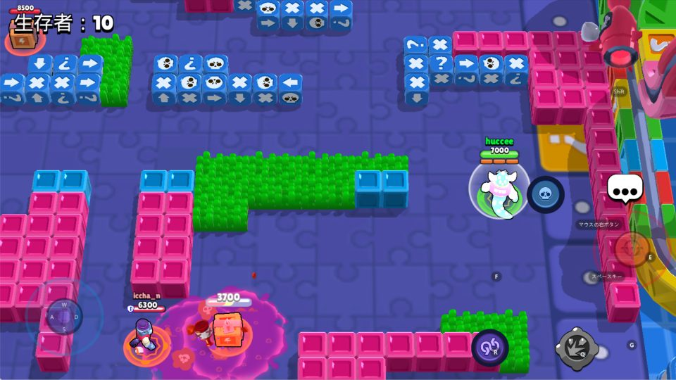
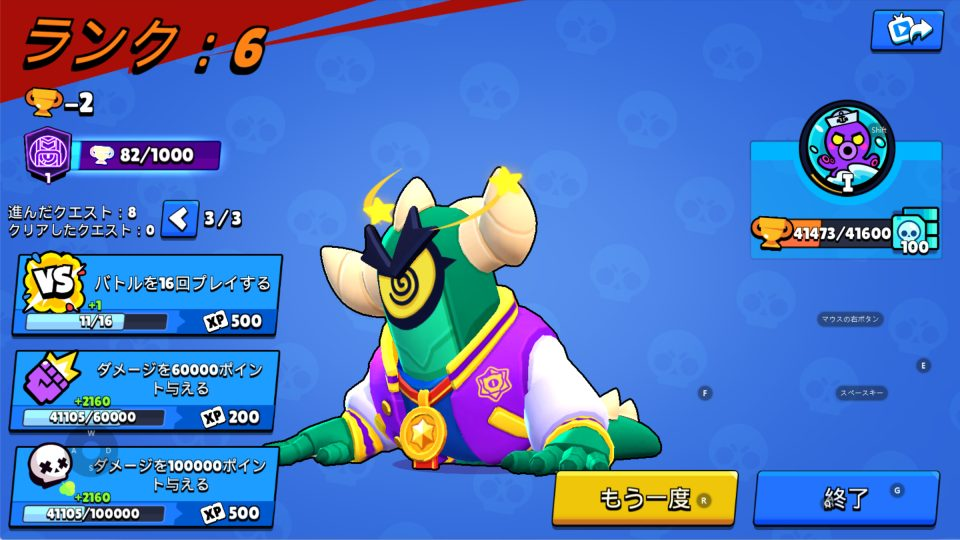
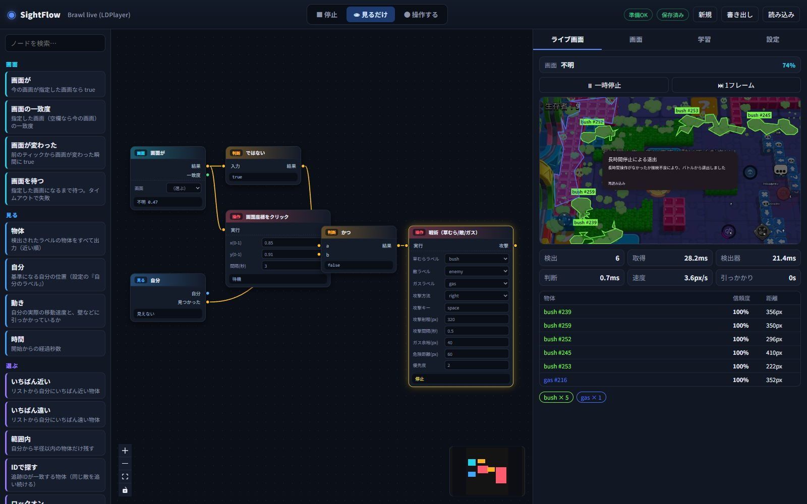

# LDPlayer の実アプリで動かす（実戦テスト記録）

LDPlayer 14 上で動作しているブロスタ風アプリを、SightFlow で実際に
「ロビー → ソロバトルロイヤル開始 → 戦術実行 → リザルト」まで動かした記録です。

> オンラインゲームの自動操作は利用規約で禁止されている場合があります。
> 自分が運営・所有する環境、または自動化が許可された環境でのみ使用してください。

## 実測結果（2026-11-05）

| 項目 | 結果 |
|---|---|
| キャプチャ | LDPlayer の子ウィンドウ `TheRender`（2400x1350）を 960x540 に正規化 |
| ロビー画面登録 | 類似度 **0.98〜0.99** で安定一致 |
| メニュー操作 | ロビー検出 → **プレイ** を自動クリック → 試合開始 |
| 試合中の行動 | ガス回避 / 草むらへ移動 / 草むらで潜伏 / 敵へ右クリック攻撃 |
| 自己位置検出 | 緑のHPバー（HSV 50-62, S140+, V190+、横長フィルタ） |
| 最高順位 | **6位 / 10人**（複数回実行。優勝は未達） |
| ティック記録 | 1試合あたり 300〜500 ティック、自己検出できたのは 37〜120 ティック |

実際の試合画面（自動操作前のキャリブレーション用フレーム）:



リザルト画面（ランク6）:



試合中のWebUI（ライブ画面・検出枠・草むら/ガス領域・検出一覧・ノード状態）:



ロビーの「プレイ」だけでなく、**長時間停止で退出したときの「再読み込み」画面もマクロが画面検出して自動クリック**します。

## 起動

LDPlayer を起動し、対象ゲームを前面に表示しておきます。

```bash
python -m sightflow web --template brawl_live --port 8790
```

ブラウザで `http://127.0.0.1:8790` を開きます。

1. **見るだけ** にする
2. **画面** タブで、ロビー（プレイボタンが見えている画面）を `lobby` として登録
3. **ライブ画面** タブで **操作する**
4. ロビー検出 → プレイクリック → 試合開始 → 戦術が動く

ゲームウィンドウが前面でない間は、誤入力を防ぐため入力を自動停止します
（`game window is not in the foreground`）。LDPlayer をクリックすると再開します。

## 設定の要点

`templates/brawl_live.json`:

- source: `window` / `LDPlayer` / process `dnplayer.exe` / child `TheRender` / width 960
- 入力: WASD（LDPlayer のキーマップに合わせる）
- 戦術: `attack_mode: right`（マウス右ボタン＝通常攻撃のスマートキャスト）
- ガス: マゼンタ系の領域。壁も同じ色に寄るため `gas_danger` を 60px まで下げ、
  草むら潜伏を優先
- 草むら: 緑の領域（`min_area: 3000`）
- 敵: 赤いHPバー（横長・高さ2〜12pxに制限して、ダメージ数字やUIを除外）

## 既知の制約

- 壁のマップを持っていないため、壁越しの草むらへ直進して詰まることがあります。
  スタック時は同じ方向へ回り込み、3回詰まった草むらを5秒間諦めますが、
  完全な経路探索ではありません。
- ガスとピンク色の壁を色だけで完全には分離できません。しきい値を下げて
  誤検知の影響を抑えていますが、終盤のガスでは手動確認が必要です。
- 再読み込み画面のクリック座標は 960x540 基準で `(0.296, 0.587)`。ウィンドウの
  レイアウトを変えた場合はスクリーンショットから測り直してください。
- 敵のHPバーはダメージ数字と近い色・形をしているため、至近距離では
  誤検出が残ります。
- 優勝を安定して狙うには、壁マップの作成、敵の弾/攻撃範囲の検出、
  キャラクター固有の攻撃レンジの学習が必要です。
